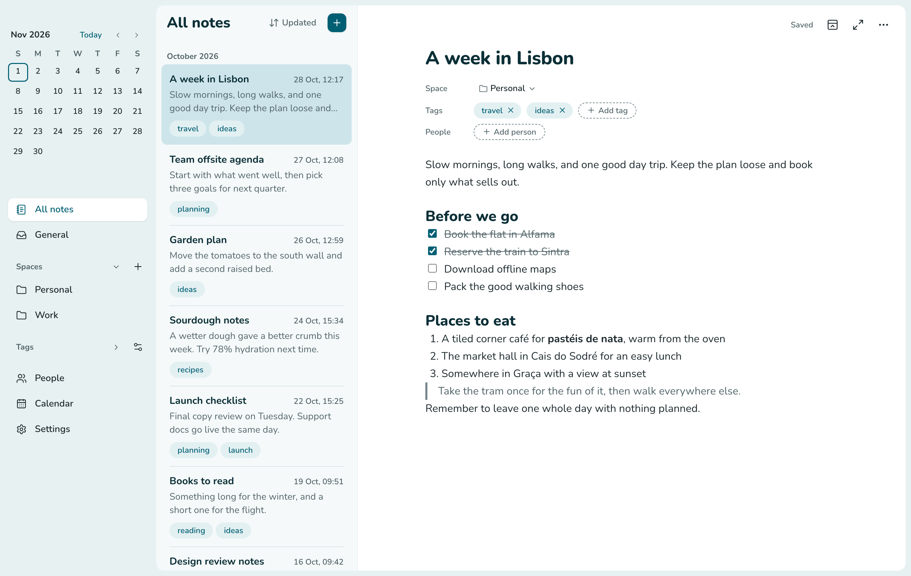
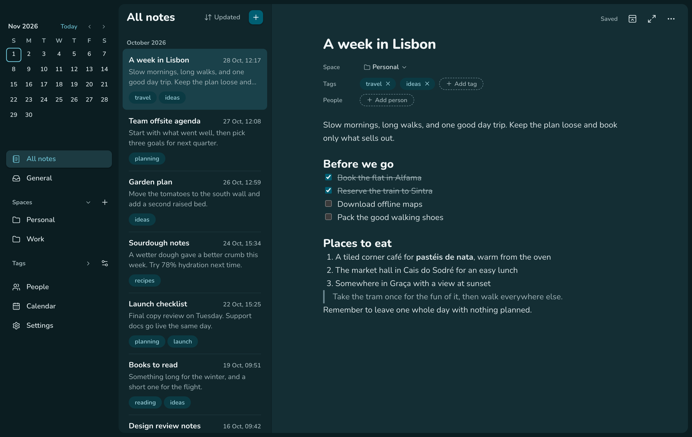

The first release of borNote, a calm note-taking app for macOS. Your notes are plain Markdown files in a folder you own, so they stay readable without the app.

## What's in it

- **WYSIWYG writing:** type in a clean editor, with no blocks, and borNote saves Markdown.
- **Spaces and tags:** keep each note in one Space or none, and add as many tags as you like.
- **Search:** fast full-text search with filters.
- **Images:** add images inline.
- **Meeting notes:** see your Mac's calendars in an agenda and take notes on an event. A People section tracks who attended. borNote only reads your calendar.
- **Your own sync:** keep the folder in OneDrive, Google Drive, iCloud Drive or Dropbox, and let that provider's app sync it. borNote picks up changes made outside the app.
- **Zen mode and themes:** write without distractions, in light or dark.

## Download

Get the latest version from the [Releases page](https://github.com/borna761/bornote-releases/releases/latest).

1. Download the `.dmg` for your Mac: `aarch64` for Apple Silicon, `x64` for Intel. Requires macOS 13 or later.
2. Open it and drag borNote into Applications.
3. Open borNote and pick a folder for your notes.

The app is signed with a Developer ID and notarized by Apple, and it updates itself from this repo.

This repo holds only the downloads.
